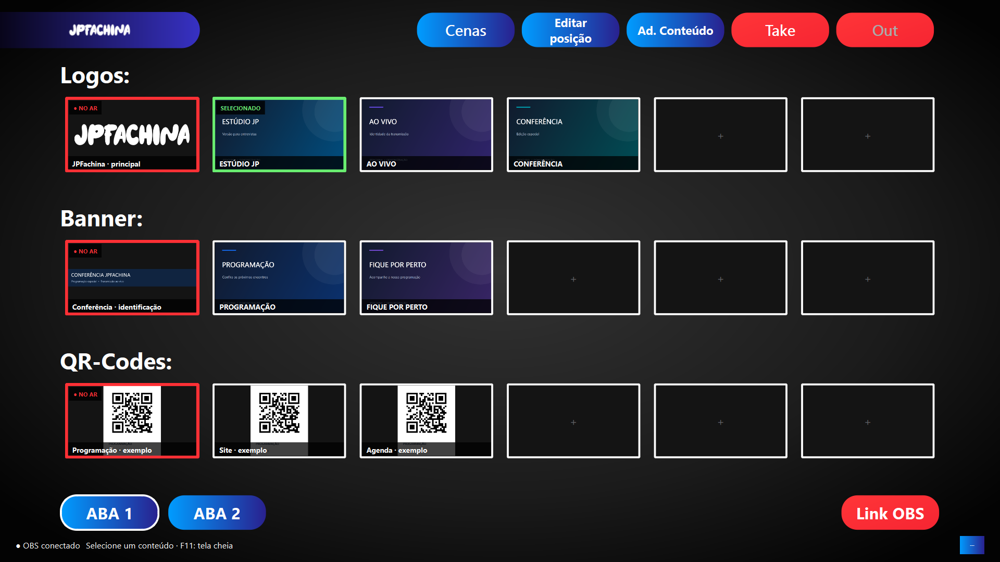
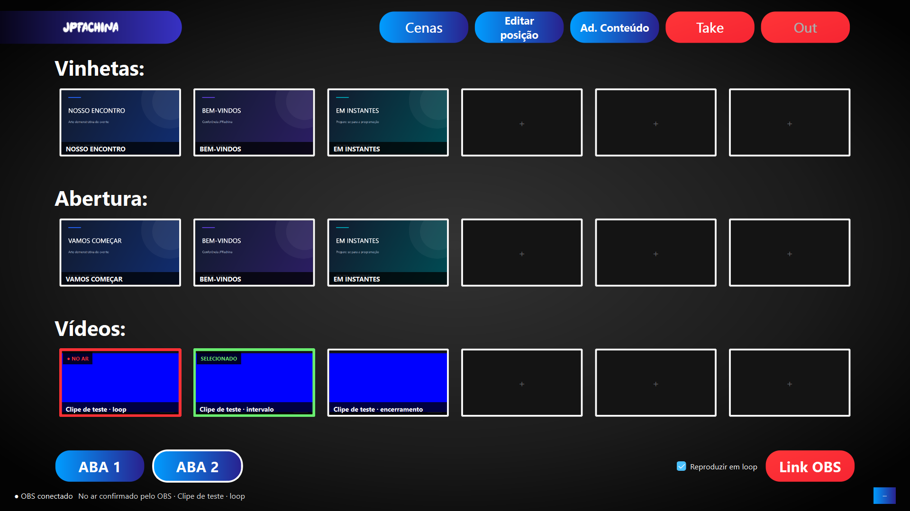
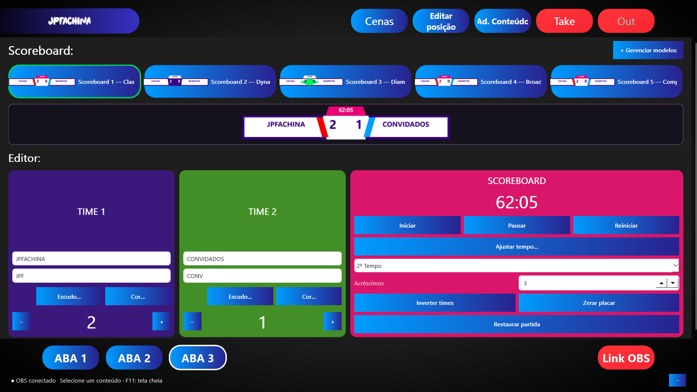

# JP Fachina Graphics 1.0.3 beta

Plugin de grafismos para **OBS Studio 33.0.1 / Qt 6.11.1 / Windows x64**. O painel nativo tem três abas: mídias, vinhetas e uma central de Scoreboard com cinco modelos, editor de partida e prévia.

## Download

| Arquivo | Finalidade |
| --- | --- |
| [Instalador Windows x64](downloads/1.0.3-beta/JP-Fachina-Graphics-1.0.3-beta-Windows-x64-Setup.exe?raw=true) | Instalação normal |
| [Pacote ZIP](downloads/1.0.3-beta/JP-Fachina-Graphics-1.0.3-beta-Windows-x64.zip?raw=true) | Instalação manual ou OBS portátil |
| [Código-fonte ZIP](downloads/1.0.3-beta/JP-Fachina-Graphics-1.0.3-beta-Fontes.zip?raw=true) | Arquivo de fontes da versão |
| [Checksums SHA-256](downloads/1.0.3-beta/SHA256SUMS.txt) | Verificação de integridade |
| [Resultado dos testes](downloads/1.0.3-beta/TESTES-1.0.3-beta.md) | Validação e limites |

Feche o OBS antes de instalar. Em **Link OBS**, associe a composição JP Fachina Graphics à cena. Selecione o modelo na **ABA 3** e use **Take** e **Out**. Os dados da partida atualizam o placar no ar.

Para mover apenas o placar, selecione-o e use **Editar posição → Scoreboard**. Arraste, redimensione ou ajuste os números; **Salvar** prepara o próximo Take e **Salvar e aplicar no ar** também altera a saída atual. Transformar a fonte composta diretamente no OBS afeta todos os seus grafismos.

## Imagens

Capturas reais da versão beta no ambiente de teste isolado com OBS 33.

### Aba 1 — Mídias

### Aba 2 — Vinhetas

### Aba 3 — Scoreboard

### Saída no OBS

Veja também o [editor de posição, projetos e Link OBS](docs/SCREENSHOTS.md).

## Documentação

- [Instalação e operação](LEIA-ME.md)
- [Scoreboards e posicionamento](docs/SCOREBOARDS.md)
- [Compatibilidade OBS 33](docs/FIX-OBS33-0.4.1.md)
- [Compilação](docs/BUILD.md)
- [Histórico](CHANGELOG.md)
- [Instruções para publicar](docs/PUBLISH.md)

O código é GPL-2.0-or-later. A marca JP Fachina tem direitos próprios; veja [proveniência](assets/branding/PROVENANCE.json).
