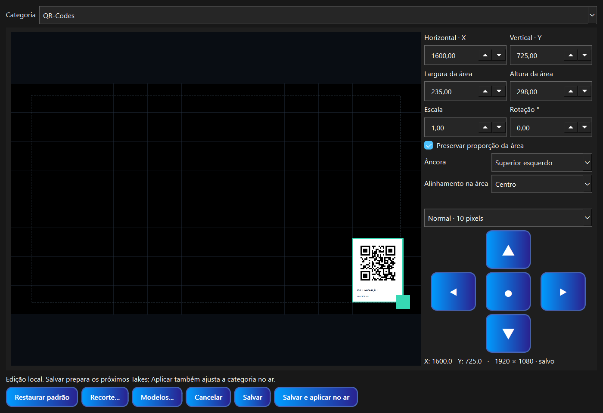
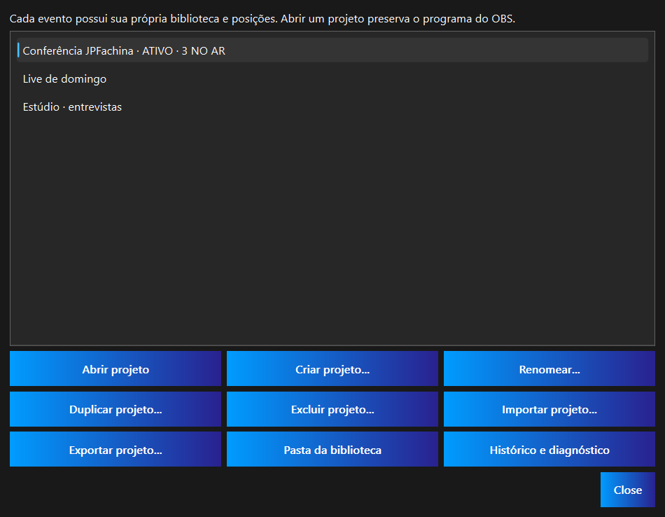

# JPFachina OBS Controller

Controle de grafismos para **OBS Studio 33.0.1 no Windows x64**, com painel nativo,
projetos independentes e posicionamento por categoria.

## Baixar e instalar

**Versão 0.4.1 · OBS 33.0.1 · Qt 6.11.1 · Windows x64**

| Arquivo | Uso |
| --- | --- |
| [Baixar instalador EXE](downloads/0.4.1/JP-Fachina-Graphics-0.4.1-Windows-x64-Setup.exe?raw=true) | Instalação normal no Windows |
| [Baixar pacote ZIP](downloads/0.4.1/JP-Fachina-Graphics-0.4.1-Windows-x64.zip?raw=true) | Instalação manual ou OBS portátil |
| [SHA-256](downloads/0.4.1/SHA256SUMS.txt) | Conferir a integridade dos arquivos |

1. Feche o OBS e execute o instalador. Se a pasta exigir permissão, execute como administrador.
2. Abra o OBS e habilite o plugin no gerenciador, se necessário.
3. Abra **Exibir → Docks → JP Fachina Graphics**.
4. Crie ou escolha seu evento em **Cenas**. Em **Link OBS**, associe a composição à cena desejada.
5. Cadastre as mídias, selecione um conteúdo e use **Take** / **Out**.

O instalador preserva a biblioteca existente. Este pacote usa o Qt 6.11.1 do OBS
33.0.1; o pacote antigo com Qt 6.8.3 não serve para esse ambiente. Veja
[compatibilidade](docs/COMPATIBILITY.md) e o [manual completo](LEIA-ME.md).

## O que o plugin faz

- **Duas abas:** Logos, Banner e QR-Codes; Vinhetas, Abertura e Vídeos.
- **Miniaturas 16:9:** seis espaços por categoria, com paginação para bibliotecas maiores.
- **Operação por categoria:** Take substitui a mesma categoria; Out preserva as demais.
- **Tally real:** verde indica seleção; vermelho exige confirmação no programa do OBS.
- **Editor dedicado:** arraste, redimensione, informe X/Y e use setas grandes com passos de 1, 10 ou 50 pixels.
- **Edição local:** Salvar prepara os próximos Takes; Salvar e aplicar no ar atualiza a categoria publicada.
- **Projetos/eventos:** criar, renomear, duplicar, selecionar, importar/exportar e excluir com confirmação.
- **Link OBS:** integração nativa ou WebSocket 5 autenticado, associação de cenas/fontes e reconexão.
- **Vídeos:** loop e comportamento de término individuais. A reprodução de vídeo permanece silenciosa.

Trocar de projeto preserva os conteúdos anteriores no ar. Cada projeto possui
suas próprias posições, biblioteca e associações. O plugin opera as fontes que
pertencem ao seu gerenciamento.

## Imagens em uso

As imagens foram capturadas da interface Qt real, conectada a uma instância
isolada do OBS. A saída abaixo foi renderizada pelo OBS com logo, banner e QR-Code.
Os exemplos são demonstrativos; não contêm uma biblioteca pessoal.

| Vídeos e segunda aba | Editor de posição |
| --- | --- |
|  |  |

| Projetos e eventos | Associação às cenas do OBS |
| --- | --- |
|  |  |

[Galeria e instruções para reproduzir as capturas](docs/SCREENSHOTS.md).

## Código e desenvolvimento

O código-fonte do plugin está em `src/`. O painel HTML em `web/` mantém a
compatibilidade com integrações anteriores. Os arquivos de instalação estão em
`downloads/0.4.1/`, e os avisos de terceiros estão em `vendor/`.

- [Compilar, testar e empacotar](docs/BUILD.md)
- [Validação desta cópia](docs/VALIDATION.md)
- [Histórico de versões](CHANGELOG.md)
- [Contribuir](CONTRIBUTING.md)
- [Publicar este conteúdo no GitHub](docs/PUBLISH.md)

A validação da versão inclui cinco suítes nativas, renderização D3D11 e conexão
autenticada com OBS real. Operação prolongada, transmissão externa, outro
computador físico e DPI misto ainda exigem homologação no ambiente de uso.

Código sob **GPL-2.0-or-later**. Veja [LICENSE](LICENSE). A identidade visual
JPFachina tem os direitos indicados em `assets/branding/PROVENANCE.json`.
