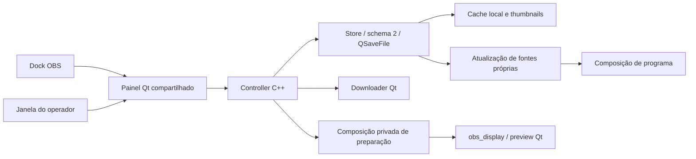

# Arquitetura 0.2 — operador Qt e composição OBS

A versão 0.2 mantém o Store, o downloader e a biblioteca existentes. A interface
principal passa a usar Qt Widgets e chamadas C++ diretas ao controlador. O
compositor é uma fonte OBS registrada como `jp_fachina_composition`.

## Responsabilidades

| Arquivo | Responsabilidade |
| --- | --- |
| `src/controller.*` | Seleção e preparação únicas, comandos, estado OBS e histórico de sincronização |
| `src/operator-panel.*` | Interface de operação, categorias e formulário de posicionamento |
| `src/operator-dialogs.cpp` | Sincronização manual, modelos, mídia e projetos |
| `src/position-canvas.cpp` | Editor visual com guias, escala, âncora, rotação e recorte |
| `src/operator-window.*` | Modos de janela, identidade do monitor, persistência e recuperação |
| `src/obs-native.*` | Fonte OBS, cenas privadas, animações, opacidade e display de preview |
| `src/plugin-main.cpp` | Ciclo OBS, associação/migração de fontes, atualização e status frontend |
| `src/store.*`, `src/store-operations.cpp` | Persistência, importação, transformações e transações |
| `src/downloader.*` | Download assíncrono, validação e passagem à fila de cache |
| `src/title-image.hpp` | Renderização determinística do modelo de tarjeta |

## Estado e publicação

Há um único painel transferido entre o dock e a janela; seleção e preparação
não são copiadas. O dock mostra um resumo e os comandos de retorno quando o
operador está destacado. Abrir, restaurar e mover janelas não chama TAKE, OUT
nem cria fontes.

`draft` contém preparação; `live` contém o último layout publicado. TAKE valida
a disponibilidade do arquivo e prepara o recurso de texto antes da publicação.
OUT remove a peça do snapshot publicado. CLEAR é limitado ao projeto ativo e
pede confirmação. Desativar uma peça publicada exige retirá-la primeiro.

O preview usa outra instância privada do compositor e outras fontes privadas.
Nenhum objeto de mídia de preparação é compartilhado com o programa. A seleção
vazia produz preview vazio. A interface distingue “publicado” de composição
ativa no programa OBS. Streaming e gravação vêm das APIs frontend.

## Renderização

Cada compositor possui uma cena privada e fontes privadas `image_source` ou
`ffmpeg_source`; imagens incluem GIF animado. A opacidade utiliza o filtro
privado `color_filter_v2`. Tarjetas são PNGs gerados localmente a partir do texto,
com cache identificado por conteúdo e dimensões. Vídeos permanecem sem áudio.

As dimensões de layout são a caixa de referência antes da escala. Recorte usa
unidades dessa caixa e é convertido em pixels da mídia. Âncora define o ponto
de referência de X/Y; alinhamento posiciona a mídia, mantendo proporção, dentro
da caixa. Opacidade vai de 0 a 100; escala de 0,01 a 20. A resolução do projeto
é independente da resolução do monitor.

Snapshots chegam por uma fila protegida; o tick de vídeo aplica alterações.
Atualizações preservam fontes cuja mídia e geração não mudaram. Nova entrada
após OUT incrementa a geração e recria apenas aquela mídia. Transformações
estáveis não são reaplicadas a cada frame. Saídas com animação mantêm o recurso
até a transição terminar. Filtros, itens, fontes, cenas e displays têm liberação
explícita. Callbacks gráficos não acessam widgets nem executam downloads.

## Persistência e IO

Schema 1 é validado e copiado para `library.schema1.backup.json` antes da
migração; se já houver backup, outro arquivo com identificador único é criado.
Schema 2 acrescenta IDs de categorias sem redistribuir mídias antigas. O método
legado de edição de categorias continua disponível para a interface antiga;
a interface Qt usa renomeação explícita e mantém o ID.

`operator.json` guarda monitor, geometria normal, modo e abertura automática.
`panel.json` guarda categoria e divisão dos painéis. Primeira execução permanece
no dock. Identificação combina nome, fabricante, modelo e serial disponíveis;
sem correspondência, o gerenciador usa uma tela disponível e limita a geometria.

Importações de arquivos, preparação do cache e importação/exportação de projetos
executam IO em threads de trabalho. Mídias entram em uma fila com dois workers;
o Store aceita o resultado e persiste na thread principal. Downloads conservam
limites de rede e usam a mesma fila. Binários novos de importação local são
reutilizados por SHA-256. O encerramento cancela a fila e aguarda os workers.
Snapshots JSON de metadados ainda são gravados atomicamente na thread principal;
bibliotecas próximas dos limites exigem medição adicional de latência.

Exportação produz uma pasta com `project.jpgfx.json` e mídias. O manifest só é
finalizado depois dos arquivos. Importação valida caminhos e formatos, gera
IDs/chave novos e inicia as peças fora do ar. Falhas não publicam projeto parcial.

## Sincronização

A seleção de propriedades é uma máscara explícita. Todos os destinos são
validados antes de um único commit. A operação só altera propriedades visuais
de `draft`; conteúdo, nome, arquivo, URL e `live` permanecem intactos.

Desfazer/refazer guarda valores anteriores e posteriores da máscara, por
projeto. Antes de restaurar, verifica se os campos ainda têm o valor esperado.
Mudanças posteriores incompatíveis cancelam toda a restauração. Histórico de
comandos é limitado a 50 sincronizações; mensagens operacionais a 200 entradas
por sessão. Modelos persistem propriedades visuais sem conteúdo individual.

## Compatibilidade com 0.1

Os arquivos `web/*` e o servidor original permanecem para compatibilidade e
testes. O plugin inicia HTTP em loopback somente quando encontra Browser Sources
próprias ainda referenciadas por cenas, inclusive grupos/cenas aninhadas. Sem
essas referências, o caminho normal não abre servidor HTTP.

“Associar ao OBS” cria/reutiliza uma fonte nativa por projeto. Para fontes antigas,
o diálogo confirma a cena e a migração. As substituições preservam transformação,
recorte, ordem e visibilidade; fontes de terceiros não são modificadas. Cenas
aninhadas compartilhadas podem afetar outras cenas que as reutilizam. Uma cena
com saídas antigas e nativas misturadas é recusada para evitar duplicação.

Concluir a migração de todas as cenas desativa o serviço legado. Recursos novos
de texto e transformações completas devem ser usados na saída nativa; a saída
HTML antiga mantém seus contratos anteriores até a migração.

## Limites de homologação

O build alvo continua OBS 32.1.0 / Qt 6.8.3 / Windows x64. A interface Qt não
depende mais de Browser Panel API 3. Fontes de imagem, mídia e filtros do OBS
precisam estar disponíveis. O conjunto de codecs suportados é o das fontes
nativas; os testes de WebM, MP4 e GIF usam arquivos concretos, sem garantir todo
arquivo desses formatos. HDR, outras versões e topologias físicas de dois
monitores ainda exigem ensaios específicos.
