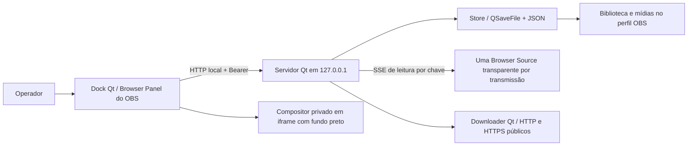

# Arquitetura

> Documento da versão 0.1. Para a versão atual, consulte
> [Arquitetura 0.2](ARCHITECTURE-0.2.md). O caminho HTML abaixo permanece apenas
> como compatibilidade durante a migração de fontes antigas.

## Ciclo de vida

`obs_module_load` registra callbacks oficiais. Depois de
`OBS_FRONTEND_EVENT_FINISHED_LOADING`, o plugin abre sua biblioteca, obtém uma
trava exclusiva, inicia o servidor e solicita a inicialização do navegador.
Essa inicialização é assíncrona: `QCef::init_browser()` retornar `false` significa
que ela acabou de começar. Um timer aguarda `initialized()` sem bloquear a UI,
com prazo de 20 segundos. Em seguida, `obs_frontend_add_dock_by_id` registra o
widget. O OBS/Qt administra o acoplamento e a posição do dock.

Em `OBS_FRONTEND_EVENT_EXIT` ou unload, o browser do painel é fechado antes de
liberar a interface QCef, o dock é removido, os downloads e consultas DNS são
cancelados, os sockets são fechados e a trava é liberada. Não há servidor Node,
Firebase ou processo auxiliar próprio do plugin. Os subprocessos CEF pertencem
ao obs-browser e seguem o ciclo de vida do OBS.

## Persistência

`obs_module_config_path` define o diretório de dados; nada essencial é salvo em
arquivos temporários. `library.json` tem schema 1, porta, seleção ativa e projetos.
Cada projeto guarda ID UUID, chave aleatória de 256 bits, categorias, resolução e
mídias. Cada mídia referencia um arquivo local por UUID, tipo, tamanho, origem,
miniatura, preparação `draft`, estado `live` e contador `generation`.

Toda alteração é escrita com `QSaveFile` antes de substituir o estado em memória
e transmitir um evento. Falha de escrita não aplica um comando ao estado no ar.
A biblioteca tem trava de instância e limite de tamanho. Erros de leitura
preservam o arquivo original. Binários importados são copiados para a biblioteca;
o projeto não depende da localização original do arquivo. Remoção de metadados
preserva os binários para recuperação e exige manutenção manual após backup.

## Preparação e estado no ar

Editar posição, tamanho, ordem, repetição ou transição modifica apenas `draft`.
`media.on` copia `draft` para `live`; `media.off` limpa `live`. Publicar de novo
uma arte já no ar atualiza seu layout sem incrementar `generation`. Uma nova
entrada após retirada incrementa o contador e reinicia só aquela mídia.
`live.clear` limpa apenas o projeto explicitado no comando.

O compositor mantém um mapa por ID e preserva elementos DOM de mídias sem
alteração de arquivo/geração. As animações acontecem no elemento de mídia,
separadas da geometria do wrapper. Saídas pendentes podem ser canceladas em
reativações rápidas. Não há temporizador que retire automaticamente uma arte.
Vídeos sem repetição param no último quadro e continuam no ar até retirada.

O preview usa o mesmo compositor, com flag específica e fundo preto. Recebe
mensagens apenas do painel de mesma origem e não assina o stream no ar. Arraste
e redimensionamento ocorrem em coordenadas 1920 × 1080. Miniaturas de imagens e
vídeos são capturadas no navegador ao preparar a mídia e salvas via API; vídeos
não preparados ainda mostram um ícone até a primeira captura.

## Comunicação e proteção

- Escuta exclusivamente em IPv4 `127.0.0.1`, porta persistente 28741 por padrão.
  Conflito de porta gera erro; o plugin não muda URLs nem fontes silenciosamente.
- `Host` exato e `Origin` de mesma origem; sem CORS. Pedidos cross-site são
  rejeitados. Não há acesso a arquivos arbitrários por URL.
- Token de sessão aleatório separado das chaves de overlay. O painel recebe
  esse token no fragmento inicial, guarda na sessionStorage e remove o fragmento
  do histórico. Todas as operações mutáveis exigem `Authorization: Bearer`.
- `/control-events` usa fetch streaming autenticado. `/events/<chave>` fornece
  snapshots de leitura do projeto via EventSource; reconnect é idempotente.
- A chave da URL do overlay é uma capacidade de leitura da biblioteca daquele
  projeto. Não autoriza comandos, não expõe caminhos locais nem drafts no stream.
- Headers e corpos são limitados. Cada arquivo é enviado em blocos com
  backpressure e suporte a HTTP Range, inclusive ranges de sufixo. Clientes
  lentos são desconectados; o máximo é 128 conexões simultâneas.
- Recursos do painel têm CSP de mesma origem, sem scripts remotos ou inline.
  Nomes são inseridos por textContent; mídias são servidas com MIME validado e
  `nosniff`. O preview aceita só URLs locais em `/media/`.

O controle de acesso protege contra páginas remotas e comandos sem token. Um
processo malicioso com acesso ao perfil do mesmo usuário já pode ler a biblioteca;
não se promete isolamento de um computador comprometido.

## Downloads

Só HTTP(S) com portas padrão 80/443, sem credenciais, fragmentos ou redirects.
O DNS é validado; endereços locais, privados, multicast e intervalos reservados
são bloqueados. A conexão é fixada no IP público aprovado, usa Host e verificação
TLS do hostname original. HTTP/1.1 é explícito para preservar Host ao fixar IP;
HTTP/2 derivaria `:authority` da URL literal de IP. Não usa proxy.

Há até dois downloads simultâneos, no máximo 256 MB cada, timeout de inatividade
de 30 segundos e prazo total de 120 segundos. Content-Type e assinatura de mídia
são verificados; HTML e SVG não são importados. Arquivo temporário de download
fica no diretório de dados, é autoclean e só vira item persistente após cópia
completa e commit. Imagens têm limite de 64 megapixels. WebM exige EBML com
identificação WebM; MP4 exige marca compatível. Decodificação final depende do CEF.

O backend Schannel de Qt 6.8.3 vai na pasta de dados do plugin e é descoberto
por `QCoreApplication::addLibraryPath`, sem substituir QtNetwork do OBS.

## Integração com cenas

O painel solicita a operação e uma caixa nativa mostra a transmissão e a cena
que será alterada. Somente após confirmação o plugin cria/reutiliza uma
`browser_source`. Fontes próprias têm o campo `jp_fachina_project`. Fontes
arbitrárias com nome igual não são sobrescritas. Atualizar uma URL própria
divergente também exige confirmação. A referência da cena é mantida durante o
diálogo; trocar a cena nesse intervalo não muda o alvo que foi informado.

O fluxo adiciona somente a fonte e salva via frontend API. Não alterna cenas,
não altera câmeras, áudio, transmissão do OBS nem configurações de outras fontes.
Se uma fonte própria já está na cena, não duplica o item nem muda sua visibilidade.

## Arquivos principais

| Arquivo | Responsabilidade |
| --- | --- |
| `src/plugin-main.cpp` | Ciclo OBS, dock QCef, diálogos nativos e criação de fonte |
| `src/store.cpp` | Modelo persistente, importação e separação draft/live |
| `src/server.cpp` | HTTP, autenticação, SSE, recursos e ranges |
| `src/downloader.cpp` | Downloads restritos e cópia local |
| `web/panel.*` | Operação da biblioteca e preview |
| `web/overlay.*` | Composição transparente e transições por elemento |
| `src/dev-main.cpp` | Mesmo serviço de produção fora do OBS para desenvolvimento |
