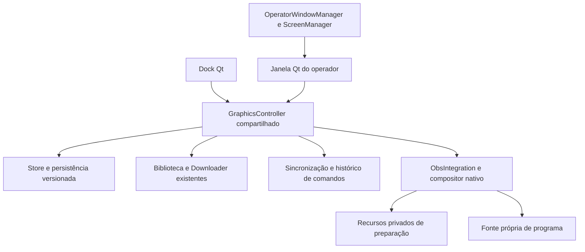

# Auditoria e plano técnico — JP Fachina Graphics

Data: 10 de novembro de 2026 (America/Sao_Paulo).

Situação: plano aprovado pelo usuário nesta conversa. O texto registra a
auditoria anterior à implementação; a entrega 0.2 está documentada em
[Arquitetura 0.2](ARCHITECTURE-0.2.md) e
[Validação 0.2](VALIDATION-0.2.md). As pendências de homologação física e ensaio
prolongado estão identificadas no relatório, sem serem declaradas concluídas.

## 1. Projeto encontrado

O projeto é um plugin C++17/Qt6 para OBS, versão 0.1.0. O alvo existente é
OBS 32.1.0 x64, Qt 6.8.3 e MSVC. Não é necessário refazer a biblioteca,
o downloader, os mecanismos de persistência ou o empacotamento.

Foram examinados todos os arquivos próprios em `src`, `web`, `tests`, `scripts`,
`docs`, os arquivos CMake, recursos, configuração e identidade visual. Os SDKs
e componentes de terceiros foram consultados nas interfaces relevantes.
Não há `AGENTS.md` aplicável encontrado nem diretório `.git` nesta pasta.
As seis imagens de referência não estão no repositório nem no anexo recebido;
há apenas a logo SYNC original, que deve ser preservada.

| Área | Implementação atual | Aproveitamento / lacuna |
| --- | --- | --- |
| Integração | `src/plugin-main.cpp`: ciclo OBS, widget QCef e associação de Browser Source por projeto | Preservar identificação de fontes próprias e disciplina de referências; extrair responsabilidades |
| Modelo | `src/store.*`: projetos, UUIDs, categorias, mídias e snapshots `draft`/`live` | Reutilizar; ampliar schema e comandos |
| Persistência | JSON, `QSaveFile`, `QLockFile`, validações e limites | Reutilizar; adicionar migração, backup e preferências de interface |
| Mídia | `src/downloader.*`: rede assíncrona, validação de destinos, limites, TLS e cópia local | Reutilizar; importação de arquivos ainda faz cópia síncrona |
| Transporte | `src/server.*`: HTTP em loopback, autenticação, SSE e leitura de mídia | É servidor web interno, mesmo sem processo externo; conflita com a exigência literal de operação sem servidor |
| Interface | `web/panel.*`: biblioteca única, filtros, cards, editor e ações individuais | Fluxos úteis; organização e apresentação precisam mudar |
| Composição | `web/overlay.*`: saída transparente e transições, preservando vídeos não alterados | Preservar comportamento e testes durante a migração de renderização |
| Preview | iframe privado, sem assinatura do stream de programa | Já existe isolamento de preparação; preservar também no novo renderer |
| Operador | Dock desacoplável pelo OBS | Não há janela gerenciada, monitor persistente, F11/Esc ou recuperação de monitor |
| Testes | C++, Playwright, integração com serviço Qt e evidências anteriores de OBS portátil | Reutilizar e ampliar; distinguir execução atual de registros históricos |

### Comportamentos a preservar

- Preparação salva não altera `live`; TAKE publica explicitamente.
- OUT e CLEAR afetam o projeto indicado; várias peças podem ficar no ar.
- Uma atualização de posição não reinicia vídeos de outras peças.
- Cache permanece disponível sem internet; arquivos originais são copiados.
- Apenas fontes identificadas como pertencentes ao plugin podem ser gerenciadas.
- Dados corrompidos não são silenciosamente sobrescritos.
- Fontes existentes e bibliotecas não serão convertidas ao abrir a nova versão
  sem uma migração definida, recuperável e validada.

### Problemas concretos

1. `Runtime` concentra UI, inicialização e associação de fontes em um arquivo.
2. Categorias são strings; renomeação por posição pode redistribuir mídias ao
   remover/reordenar linhas. Precisam de IDs estáveis e migração explícita.
3. A resolução está no projeto, mas importação, arraste, alinhamento, seleção,
   rótulos e associação da fonte contêm constantes 1920/1080.
4. Só existem X/Y, largura/altura, camada e propriedades de transição/repetição.
   Escala, rotação, opacidade, âncora e recorte não estão implementados.
5. Tarjetas são apenas arquivos de mídia. Não há campos estruturados para nome,
   cargo e cidade nem modelos com áreas de texto.
6. Não existem sincronização, histórico de desfazer, duplicação ou portabilidade
   de projetos pela interface.
7. O indicador de conexão informa o serviço local, não confirma presença da
   fonte na cena, visibilidade no programa ou estado streaming/recording do OBS.
8. A saída HTML preserva o último estado quando perde o serviço. Deve haver
   diagnóstico de integração e política de recuperação explícita.
9. Copiar arquivos grandes e persistir JSON completo acontecem na thread da UI;
   é necessário medir e remover bloqueios relevantes antes de homologar.

## 2. Decisão de arquitetura proposta

Adotar uma interface nativa Qt Widgets e um controlador C++ compartilhado,
reaproveitando `Store` e `Downloader`. Dock e janela de operação chamam o
controlador diretamente por métodos/sinais Qt, sem HTTP, WebSocket ou aplicativo
independente para controlar o OBS.

Há uma decisão material: o compositor atual também depende do servidor HTTP.
Para cumprir literalmente o briefing, a entrega final deve migrar essa parte
para composição nativa OBS. Apenas retirar o HTTP do painel deixaria uma
dependência de servidor web na saída.

Proposta: fonte de composição própria do plugin, com cenas/fontes privadas para
mídia e texto, e renderização de preview separada do programa. As APIs necessárias
existem nos headers locais do OBS 32.1.0 (`obs_source_create_private`,
`obs_scene_create_private`, `obs_display_create`, transformações e crop).
Opacidade e transições precisam de implementação específica de composição;
não serão tratadas como simples campos de transformação de item de cena.

A migração do compositor é delimitada e motivada pelo requisito sem servidor;
não implica reescrever persistência, projetos, cache e download. Durante o
desenvolvimento, o compositor atual continua como referência de comportamento.
Fontes Browser Source existentes exigem caminho de migração: não é possível
trocar seu tipo simplesmente atualizando propriedades. Não remover nem ativar
duas saídas sobrepostas automaticamente. Preparar a fonte nativa sem exibição,
validar equivalência e realizar a substituição das associações próprias em
operação de manutenção, preservando transformações e possibilidade de retorno.

Antes de desativar o renderer atual, demonstrar equivalência para imagens,
GIFs animados, WebM/MP4, transparência, repetição, último quadro e transições.
Diferenças de codec entre CEF e fontes nativas são risco de compatibilidade real.
Se houver formato sem equivalência, registrar a limitação e resolver o suporte
antes de declarar a migração concluída; não retirar silenciosamente o recurso.

Divisão sugerida, adaptável à implementação:

- `src/ui/`: OperatorPanel, CategoryPanel, dock, janela e editor visual.
- `src/controller/`: comandos, estado compartilhado e resultados operacionais.
- `src/graphics/`: categorias, elementos, layouts, textos e modelos.
- `src/sync/`: seleção de propriedades, validação, resumo e histórico.
- `src/obs/`: integração frontend, fontes próprias, renderer e preview isolado.
- `src/media/`: importação, downloader, índice de arquivos e thumbnails.
- `src/projects/` e `src/persistence/`: projetos, schema, migração e preferências.
- `src/diagnostics/`: eventos, erros e diagnóstico sem expor segredos.

A extração será gradual, sem mover todos os arquivos antes de haver necessidade.
Comandos são serializados pelo controlador. IO pesado ocorre em workers com
cancelamento; commits de estado e notificações mantêm uma única autoridade.
Callbacks gráficos do OBS usam snapshots e recursos seguros para sua thread;
não acessam widgets Qt nem executam IO.

## 3. Etapas e critérios de aceite

### Etapa 1 — Fundação e nova interface (prioridade)

1. Introduzir o controlador compartilhado preservando contratos `draft`/`live`.
2. Preparar migração versionada, backup antes da conversão e teste de recuperação.
3. Criar painéis independentes para Logos, Tarjetas, Banners, Overlays e categorias
   personalizadas, cada um com biblioteca, miniaturas e preferências próprias.
4. Interface broadcast compacta: cabeçalho com projeto e estado OBS; painéis de
   categoria no centro; preview/editor e operação próximos à seleção; status e
   alertas persistentes no rodapé. Cores e rótulos distinguem seleção, preview,
   disponível, publicado, desativado e erro. Estados podem coexistir: uma peça
   no ar também pode estar selecionada e sendo preparada.
5. TAKE/OUT/CLEAR com escopos explícitos. TAKE é publicação do plugin; indicar
   separadamente se a composição está presente e visível no programa OBS,
   inclusive em Studio Mode. Não usar “conectado” como prova de que está no ar.
6. Preservar nome e marca originais; ícones consistentes e acessibilidade por
   teclado. Exibir somente ações implementadas.

Aceite: ações reais do novo dock operam o modelo existente; editar e selecionar
não publica nada; categorias não são apenas filtros de uma única lista misturada.
O primeiro incremento visual ainda não representa a entrega final sem servidor.

### Etapa 2 — Modo Operador (prioridade)

1. Janela Qt no processo OBS, registrada no ciclo de vida do plugin. Dock e
   operador reutilizam o mesmo componente de painel e controlador. Havendo duas
   visualizações abertas, nenhum estado operacional é duplicado; rascunhos
   compartilhados devem ter revisão e tratamento de edições concorrentes.
2. Modos acoplado, janela e tela cheia. Gerenciador registra estado anterior e
   geometria normal antes de expandir. Fechar operador retorna ao dock.
3. “Monitor de Operação” usa `QGuiApplication::screens()` e identidade composta
   de nome, fabricante, modelo e serial. Seriais podem estar vazios ou repetidos;
   usar fallback de identificação e correspondência, sem gravar apenas índice.
4. `setScreen()` seguido de `showFullScreen()` no monitor escolhido. F11 e Esc
   com escopo da janela ativa; Esc respeita diálogos abertos antes de restaurar.
   Botões Expandir/Restaurar utilizam o mesmo comando.
5. `screenRemoved`, mudanças de geometria e DPI retornam a janela a uma área
   visível. Tela cheia usa geometria integral; recuperação em janela usa área
   disponível. Considerar monitores à esquerda com coordenadas negativas.
6. Preferências versionadas separadas do conteúdo dos projetos: identidade do
   monitor, modo, geometria normal, painéis e abertura automática. Primeira
   execução acoplada. Restauração valida monitores e dimensões antes de aplicar.
7. Layout usa pixels lógicos do Qt; miniaturas respeitam devicePixelRatio.
   Em espaço pequeno, reorganizar painéis em abas/seções com rolagem local,
   mantendo os comandos operacionais acessíveis.
8. Encerramento/unload remove atalhos, callbacks, displays e janelas na ordem
   correta; nenhuma janela continua exibindo integração ativa após teardown.

Aceite: alternar modos não recria fontes, não executa TAKE e não interrompe
vídeos; monitor principal continua utilizável. Testar resoluções 1366×768,
1920×1080, 2560×1440 e 3840×2160, com DPI misto e reconexão física.

### Etapa 3 — Controle, posição e saída nativa

1. Compositor nativo e preview com recursos distintos: modificar e reproduzir
   preparação nunca modifica fonte de programa compartilhada.
2. Layout versionado em coordenadas da composição: X/Y, largura/altura, escala,
   rotação, opacidade, alinhamento, âncora, recorte e ordem. Definir precisamente
   se largura/altura são base ou resultado de escala; evitar aplicar escala duas
   vezes. Manter importações antigas visualmente equivalentes.
3. Editor visual com arraste, redimensionamento, guias, safe areas, grade,
   alinhamento e campos numéricos. Remover constantes 1920/1080 dos cálculos.
4. Presets por categoria, sem reposicionar automaticamente peças existentes.
5. Modelos de tarjetas com nome/cidade/cargo e texto independente da mídia.
   Persistência, preview e programa recebem o mesmo contrato de conteúdo.
6. Duplicação com UUID novo, mídia reutilizada e estado inicial fora do ar.
   Remoção e CLEAR preservam os escopos e salvaguardas existentes.
7. Integrar eventos de cena, coleção, streaming, recording e fontes removidas.
   Não seguir uma mudança de cena criando fontes novas automaticamente.
8. Concluir migração de fontes próprias e retirar a necessidade de HTTP/CEF
   para operação normal, mantendo dados e código antigos recuperáveis.

Aceite: paridade dos formatos e transições; fonte única reutilizável por projeto;
fontes alheias intactas; preview isolado demonstrado no OBS, inclusive Studio
Mode; textos e transparência corretos; operação final sem porta HTTP aberta.

### Etapa 4 — Sincronização manual

1. Fluxo origem → propriedades → destinos → resumo → aplicar.
2. Checkbox independente para cada propriedade suportada; origem excluída dos
   destinos, seleção múltipla, todos, busca e filtro por categoria.
3. Exibir quantidade de destinos, campos alterados, valores e incompatibilidades.
   Validar todos os destinos antes do commit. Cancelar não altera o modelo.
4. Aplicar uma transação sobre `draft`, sem mudar IDs, nomes, textos, URLs,
   arquivos, categoria ou `live`. Publicação continua dependendo de TAKE.
5. Desfazer/refazer restaura somente propriedades afetadas e verifica revisões;
   não restaura snapshot antigo de todo o projeto nem reverte conteúdo posterior.
6. Modelos reutilizáveis guardam valores e máscara das propriedades, não cópias
   de conteúdos individuais. Preview da operação não executa publicação.

Aceite: sincronização parcial/múltipla, incompatibilidade e erro de persistência
não causam aplicação parcial; desfazer preserva conteúdo e peças no ar.

### Etapa 5 — Biblioteca e projetos

1. Projetos independentes com importação/exportação de manifest e mídias,
   incluindo validação de caminhos, colisões de UUID e versão de schema.
2. Reutilização de binários por hash, sem apagar arquivos existentes durante a
   migração. Thumbnails assíncronos, referências estáveis e estado de arquivo ausente.
3. Reaproveitar cache e validação de download; HTTPS na interface principal e
   compatibilidade documentada com origens HTTP já salvas.
4. Favoritos, grupos e pesquisa por categoria; histórico operacional limitado
   em tamanho. Modelos e preferências com importação/exportação validada.
5. Backups recuperáveis e política explícita para retomar conteúdo publicado ao
   reiniciar. Preservar o comportamento existente até essa opção ser definida.

Aceite: reiniciar preserva biblioteca, configurações, monitor e projetos; exportar
e importar em diretório isolado funciona sem depender dos arquivos de origem.

### Etapa 6 — Estabilização e entrega

1. Ampliar testes C++ para migração, transformações, comandos, transações e undo.
2. Testes de widgets Qt e monitorização com telas simuladas para lógica de
   fallback; testes físicos para tela cheia, topologia e DPI do Windows.
3. Ensaio em OBS portátil isolado, sem modificar perfis e cenas de produção.
4. Matriz abaixo com evidências e separação entre PASSOU, FALHOU e NÃO EXECUTADO.
5. Ensaio contínuo de 4 horas com biblioteca representativa: medir CPU, RAM,
   frames perdidos, latência de comando, IO e comportamento após ciclos de UI.
   Comparar com OBS sem plugin e com a versão atual, sem prometer estabilidade absoluta.
6. Atualizar documentação, versão, licenças e pacotes ZIP/EXE após validação.

## 4. Matriz de validação obrigatória

| Item do briefing | Teste planejado / evidência |
| --- | --- |
| 1. Carregamento | DLL no OBS portátil, logs de inicialização e unload |
| 2. Dock | Registro, comandos e retorno do operador ao dock |
| 3. Janela destacada | Abrir, fechar e reabrir sem duplicar estado ou recursos |
| 4. Tela cheia | F11, Esc, botões e restauração do modo anterior |
| 5. Segundo monitor | Seleção por identidade, com ordem de telas alterada |
| 6. Resolução | Quatro resoluções solicitadas e troca durante a operação |
| 7. DPI | 100%, 125%, 150% e 200%, incluindo movimentação entre telas |
| 8. Desconexão | Remoção física e fallback; reconexão sem expansão surpresa |
| 9. Persistência visual | Reinício com monitor presente e ausente |
| 10. Operação simultânea | OBS principal e operador; rascunhos e comandos consistentes |
| 11. Cadastro | Arquivos, URL, categoria e IDs, incluindo formatos inválidos |
| 12. Posicionamento | Transformações, crop, rotação, opacidade e resolução diferente |
| 13. Sincronização | Máscaras, múltiplos alvos, resumo, falha atômica e undo/redo |
| 14. Entrada/saída | TAKE/OUT/CLEAR, repetições rápidas e preservação de vídeos alheios |
| 15. Cenas | Troca de cena/coleção, fonte removida, Studio Mode e visibilidade |
| 16. Mídia | Imagens e vídeos, alpha, download interrompido e cache offline |
| 17. Biblioteca | Reabrir, importar/exportar e migrar schema sem perda |
| 18. Reinício OBS | Preferências, dados e política de retomada no ar |
| 19. Erros | Disco sem escrita, arquivo ausente, rede, teardown e diagnóstico |
| 20. Recursos | CPU/RAM/frames/latência ao longo de 4 horas e ciclos de janela |

## 5. Verificações executadas nesta auditoria

- `cmake --build build --parallel 2`: passou com as dependências locais.
- `ctest --test-dir build --output-on-failure`: passou, 1 target `core`.
- Execução direta de `jp-core-tests.exe`: 8 grupos, 67 verificações passaram.
- `npm.cmd test`: teste da logo e 7 testes Playwright passaram.
- `node tests/native-e2e.mjs`: passou com backend Qt real, autenticação,
  isolamento por projeto, preview privado, SSE, download HTTPS e leitura do
  cache. Dados e processos permaneceram isolados; processo de teste encerrado.

Os testes Playwright usam fixtures para parte do backend; o teste native-e2e
usa serviço Qt real, mas não carrega a DLL no OBS. Os testes existentes não
validam as funcionalidades novas deste plano.

Existe cópia portátil do OBS 32.1.0 e SDK local compatível. O arquivo
`artifacts/obs-smoke-results.json` registra ensaio de 9/11/2026; é evidência
histórica, não execução desta auditoria. Não foram executados nesta etapa:
carregamento atual da DLL no OBS, operação física com dois monitores, mudanças
de DPI/resolução, desconexão física, transmissão/gravação ou ensaio prolongado.
Esses itens continuam pendentes para a implementação e homologação.

## 6. Base técnica consultada

- [OBS Frontend API](https://docs.obsproject.com/reference-frontend-api): docks
  e eventos. A documentação online é de versão posterior; disponibilidade
  conferida nos headers locais da tag 32.1.0, sem assumir atualização do OBS.
- [OBS Source API](https://docs.obsproject.com/reference-sources): ciclo de vida
  e fontes com contagem de referências.
- [Qt QScreen](https://doc.qt.io/qt-6/qscreen.html): identificação e geometria.
- [Qt QWidget](https://doc.qt.io/qt-6/qwidget.html): seleção de tela e modos de
  janela. As chamadas propostas também foram conferidas nos headers Qt 6.8.3
  locais; não se exige Qt 6.12 por ser a versão exibida na documentação online.

## 7. Aprovação solicitada

Aprovar a execução incremental deste plano, começando pela interface Qt e pelo
Modo Operador, com migração delimitada da composição para atender à exigência
sem servidor web. A aprovação não representa homologação para uso ao vivo.
Nenhum instalador novo ou alteração da instalação principal do OBS faz parte
da etapa de auditoria.
