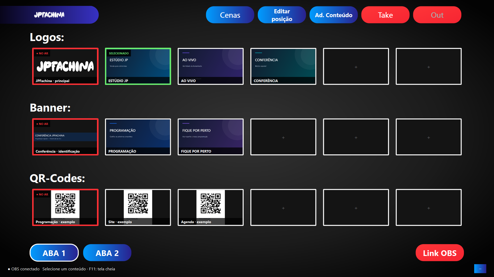
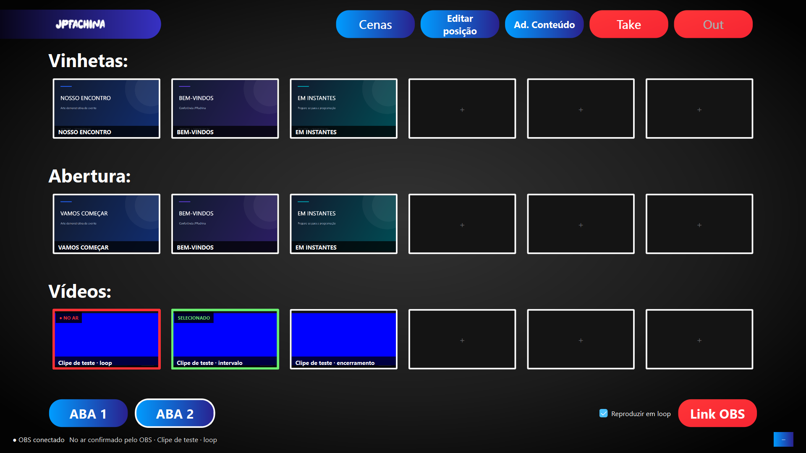
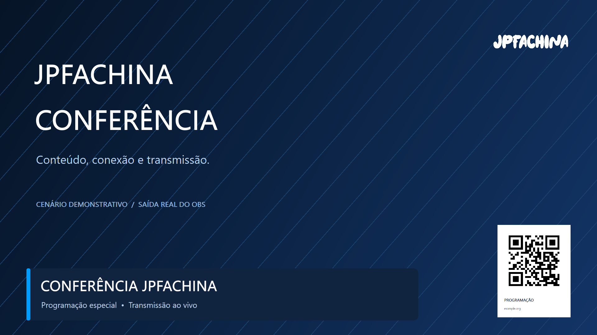
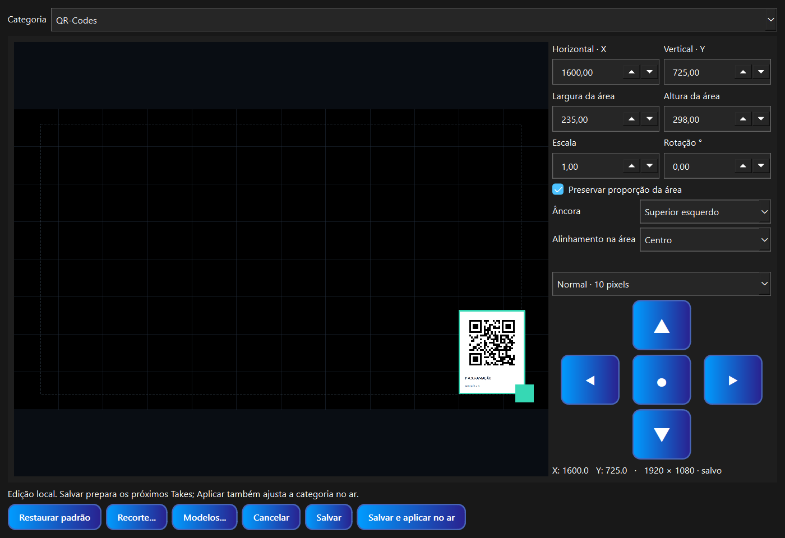
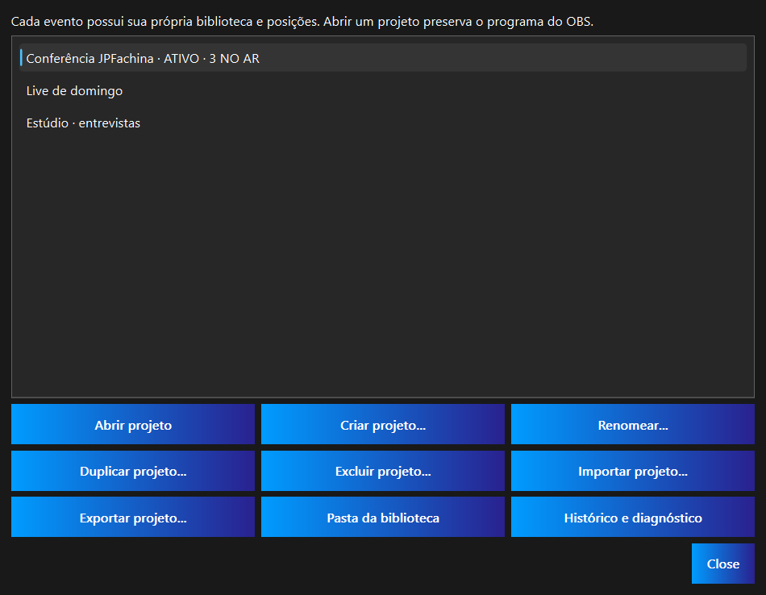
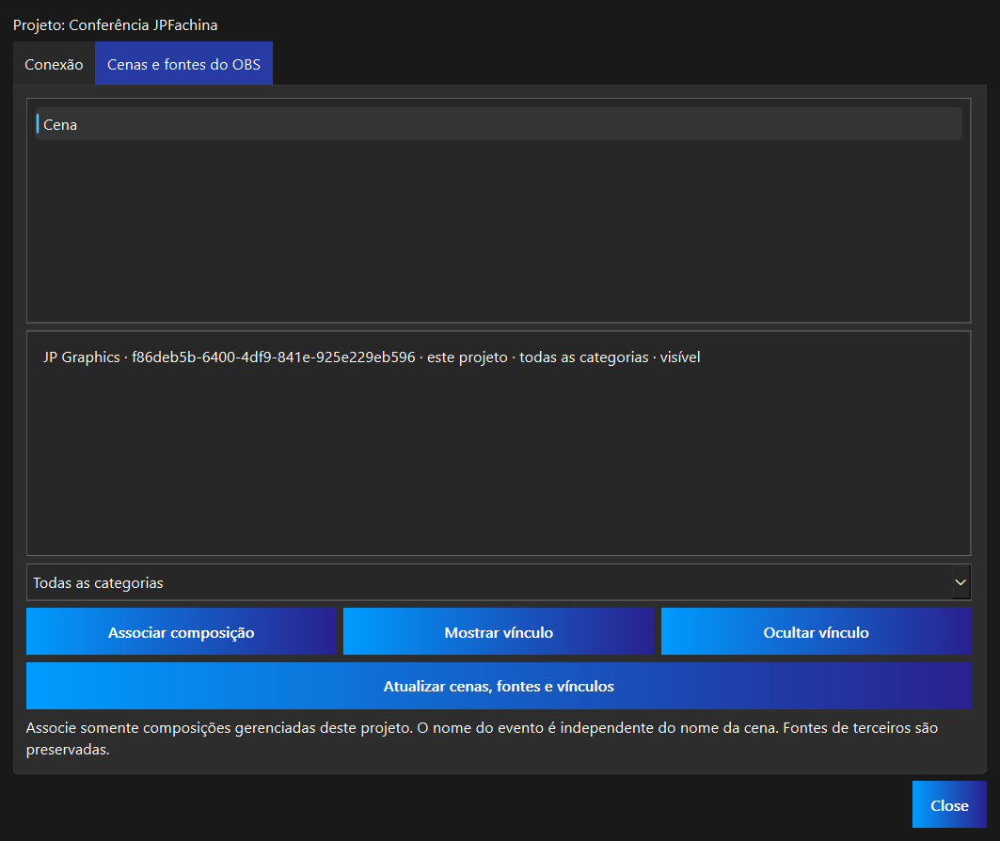

# Galeria de uso

Capturas da interface Qt de produção e da saída realmente renderizada pelo OBS,
com dados fictícios. A seleção verde e o tally vermelho foram obtidos pela lógica
do controlador e pela confirmação do OBS, sem pintar indicadores sobre as imagens.
O QR-Code da demonstração aponta para https://example.org.

## Painel principal



## Segunda aba



## Saída renderizada



## Editor



## Projetos



## Link OBS



## Reproduzir as imagens

Prepare o ambiente descrito em BUILD.md. Os exemplos de QR e os fixtures de vídeo
estão no repositório; as outras artes são geradas por QPainter. A marca original
não é modificada.

```powershell
cmake -S . -B build -DJP_BUILD_GALLERY=ON
cmake --build build --target jp-gallery jp-fachina-graphics --parallel 2
./scripts/capture-gallery.ps1 -SourceObs C:/dev/obs-portatil `
  -QtRoot C:/dev/qt-6.11.1 -BuildDirectory build
```

O script cria um OBS portátil temporário, com perfil e coleção próprios, e conecta
o utilitário `jp-gallery` por WebSocket autenticado. Os movimentos e diálogos são
os mesmos do plugin. As imagens são salvas em `docs/images`. O script encerra
somente a instância criada para a galeria; não conecta ao OBS de produção.
